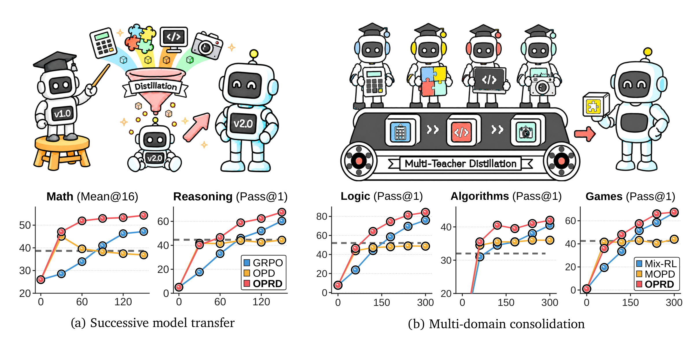
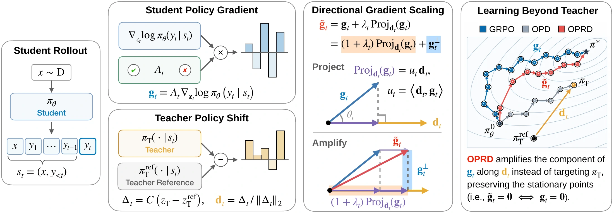

<div align="center">

# On-Policy Reverse Distillation

### Eliciting Weak-to-Strong Generalization with On-Policy Reverse Distillation

**Youngrok Park<sup>1,\*</sup>, Sangmin Bae<sup>1,\*,†</sup>, Hojung Jung<sup>1</sup>, Jongwoo Ko<sup>2</sup>, Yunseon Choi<sup>3</sup>,**  
**Young Jin Kim<sup>2</sup>, Pashmina Cameron<sup>2</sup>, Aaron Courville<sup>4,5,6</sup>, Se-Young Yun<sup>1</sup>**

<sup>1</sup> KAIST AI · <sup>2</sup> Microsoft · <sup>3</sup> University of Toronto  
<sup>4</sup> Mila · <sup>5</sup> Université de Montréal · <sup>6</sup> CIFAR AI Chair  
<sub>\* Equal Contribution · † Project Lead</sub>

[](https://arxiv.org/abs/2609.08798)
[](https://www.raymin0223.com/on-policy-reverse-distillation/)
[](https://www.python.org/)
[](LICENSE)

[Motivation](#-research-motivation) · [Method](#-method) · [Setup](#-environment-setup) · [Data](#-dataset-preparation) · [Training](#-training-and-evaluation) · [Reproduction guide](docs/reproduction.md) · [Citation](#-citation)

</div>

## 🔥 Research Motivation

Can a weaker, task-trained teacher help a stronger model improve without making the student imitate the teacher's limitations?

This question matters in two settings: **successive model transfer**, where a post-trained smaller model guides a stronger successor, and **multi-domain consolidation**, where several smaller specialists guide a single stronger student. Matching a weak teacher's final policy can constrain what the student learns. OPRD instead uses the teacher's post-training gains to accelerate the student's own verifier-driven learning.

<p align="center"><a href="https://arxiv.org/pdf/2609.08798v2#page=1"></a></p>

<p align="center"><sub><b>Figure 1.</b> A post-trained 4B teacher guides an 8B successor (left), and four 4B specialists guide one 8B student (right). Dashed lines show the weak teachers' performance. OPRD accelerates learning and allows the student to improve beyond its teachers.</sub></p>

## 🧭 Method

**On-Policy Reverse Distillation (OPRD)** uses the teacher's policy shift to rescale the student's verifier-driven policy gradient on student-generated responses.

<p align="center"></p>

1. **Sample from the student.** Generate on-policy responses and compute the verifier-driven token gradient $\mathbf g_t$.
2. **Extract the teacher's policy shift.** Subtract the frozen pre-RL reference logits from the frozen trained teacher logits, then mean-center and normalize the difference to obtain $\mathbf d_t$.
3. **Amplify the projected gradient.** Rescale the component along $\mathbf d_t$, retaining the sign of its alignment with the student's gradient:

$$
\widetilde{\mathbf g}_t = \mathbf g_t + \lambda_t (\mathbf d_t^\top \mathbf g_t)\mathbf d_t, \qquad \lambda_t \geq 0.
$$

The orthogonal component is unchanged. Positive-alignment guidance is active from the start; negative-alignment guidance ramps up during training to reinforce verifier-supported departures beyond the teacher. This transform preserves stationary points **in token-logit space**; it does not create a learning signal when the verifier gradient is zero.

The implementation constructs the direction on the sampled token plus the student's top-10 tokens, with duplicate coordinates removed. See [`oprd/geometry.py`](oprd/geometry.py) and [Section 2 of the paper](https://arxiv.org/html/2609.08798v2#S2).

This repository follows **arXiv:2609.08798v2**, including its appendix comparisons. The release tree contains training code, public dataset preparation, evaluation, and table-aggregation tools. It does not bundle model weights or generated datasets. CPU/configuration checks pass, but the updated public code has not yet been re-tested on GPUs. **GPU memory usage and long-run stability still require validation at the intended model sizes and sequence lengths.** Full-size benchmark reproduction has not yet been completed. See the [validation record](docs/validation.md).

## Release note

This public release was prepared with assistance from OpenAI Codex. Implementation details and default configurations may differ from those used in the original experiments; the included recipes define the settings used by this release.

## 🏃 Environment Setup

Use a fresh Python 3.12 environment. Experiment scripts target **four NVIDIA B200 GPUs on one node**, with FSDP DP4, rollout TP1, and BF16 mixed precision. Offline evaluation also uses DP4/TP1: each GPU loads its own model and evaluates a different question shard. Long-context models and frozen teachers require substantial GPU memory.

**Consistent loss reduction.** All RL/distillation comparisons use the same DP-wide optimizer-minibatch token mean, including variable-length Agent responses. [Normalization and scope →](docs/protocol_notes.md#loss-normalization-public-release)

**Common text rollout correction.** GRPO, OPD, KDRL and OPRD text comparisons, including teacher training, enable token-level rollout importance correction with threshold 2.0. Agent and separate appendix objectives use the settings documented in [protocol notes →](docs/protocol_notes.md#rollout-correction-and-distillation-inputs)

**Full finetuning only.** LoRA/PEFT options and adapter checkpoints are unsupported and rejected before training. Agent teacher cold-start SFT retains the original frozen vision tower/projector while training the full language model.

```bash
python3.12 -m venv .venv
source .venv/bin/activate
pip install -U pip
pip install -r requirements/train.txt
pip install -e '.[train]'
pip install flash-attn==2.8.1 --no-build-isolation
```

`requirements/train.txt` records the source runtime versions. Match the PyTorch and FlashAttention builds to your CUDA installation. Agent teacher SFT and official HumanEval+ scoring use separate environments; see the [reproduction guide](docs/reproduction.md).

Inspect the commands before allocating GPUs:

```bash
bash scripts/01_weak_to_strong/math.sh --dry-run
bash scripts/01_weak_to_strong/math.sh --stage evaluate --dry-run
```

Maintainer tests and release scans run outside this public tree; they are not runtime dependencies. Their coverage and limits are recorded in [validation](docs/validation.md).

Public downloads use the Hugging Face client's normal configuration. Credentials belong in your local environment or credential store, outside this repository. Training logs to the console and **W&B offline** by default, with project **`on-policy-reverse-distillation`**. Offline runs and checkpoints stay in the experiment's output directory. No credentials or login calls are embedded in the launchers.

## 📚 Dataset Preparation

| Domain | Training data | Evaluation |
|---|---|---|
| Math | DAPO-Math-17K | AIME'24, AIME'25, HMMT'25, OlympiadBench |
| Reasoning Gym | 19,800 examples per task | 200 examples each: Knights & Knaves, Quantum Lock, String Manipulation, Countdown |
| Code | DeepCoder Preview, 24,287 problems | LCBv5, HumanEval+, CodeContests, APPS Competition |
| Agent | ViLaSR RL, 19,200 questions | 10,464 held-out questions: Maze, GPT4Scene, SR-91k, Spatial VQA |

The appendix also evaluates Zebra Puzzles, Color Cube Rotation, and Binary Matrix.

```bash
python -m oprd.prepare --task math
python -m oprd.prepare --task reasoning
python -m oprd.prepare --task code
```

Generated files go to `datasets/`, which is ignored by Git. The reasoning generators retain the fixed seed and split rules, including Binary Matrix train/test deduplication. Math preparation reads `data/math_sources.lock.json` to select exact DAPO/AIME/HMMT revisions, verify source SHA-256 values, and check the prepared prompts/answers against the original experiment inputs. Code preparation retains the validated evaluation subsets and official HumanEval+ test snapshot. [Dataset details and Agent setup →](docs/reproduction.md#data-and-evaluation-provenance)

## 🔎 Implementation Overview

```text
scripts/                   Runnable experiments, ordered by paper section
  01_weak_to_strong/        Math, reasoning, code, Agent
  02_multi_teacher/        Four reasoning specialists
  03_strong_to_weak/        Math and Knights & Knaves
  04_method_comparison/    Appendix baseline comparisons and W2SR-P
  05_guidance_design/      Teacher strength, directions, lambda, branches
  06_additional_results/   Math-Base, extra tasks, reference/zero-reward studies
oprd/
  train.py                 Training command-line entry point
  evaluate.py              Text evaluation command-line entry point
  experiments.py           Section runner: prepare, teacher, train, evaluate
  prepare.py               Dataset preparation command-line entry point
  paper.py                 Shared models, schedules, lengths, evaluation defaults
  recipes.py               Experiment matrices and task/method variants
  geometry.py              Core OPRD support and logit-gradient transform
  rewards.py               Reward routing for the paper domains
  build_teacher_data.py    Verified teacher demonstrations for W2SR-P
  sft.py                   W2SR-P full-parameter behavior cloning
  runtime/                 Training backend, validation, tokenizers, W&B setup
  evaluation/              Four-GPU orchestration, official scoring, table aggregation
  agent/                   ViLaSR preparation, tools, rewards, training, evaluation
  code/                    Shared Code reward checkers and execution isolation
verl/                      Vendored training and rollout infrastructure
data/                      Public dataset generators and converters
docs/                      Reproduction details, source notes, validation
assets/                    Figures embedded by the README
```

**Reading order:** start with `geometry.py` for the method, `paper.py` / `recipes.py` for the experiments, and `train.py` / `evaluate.py` for execution. Open `runtime/` or `evaluation/` when changing infrastructure. `evaluation/report.py` optionally aggregates benchmark scores for the paper tables. Section 4.3 student/teacher response-style and qualitative analyses are outside this release.

**Where settings live:** `oprd/paper.py` defines shared task defaults (models, lengths, schedules, metrics); `oprd/recipes.py` defines which tasks, methods, and variants each experiment runs; `oprd/train.py` turns those into runtime options. These are the executable sources of truth, so no duplicate top-level `configs/` copies are needed. `verl/trainer/config/` contains the actual Hydra configuration schemas/defaults and must remain. `data/` contains preparation code, while ignored `datasets/` contains downloaded/generated data. `docs/` and `assets/` support documentation and are not needed by training.

Public configuration names use **OPRD** and **OPSD**. The main comparisons are **GRPO, OPD, KDRL, and OPRD**. Appendix baselines are **W2SR-P, S2L-PO, OPSD, Direct-OPD, and W2S-OPD**. Exploratory objectives and dataset launchers outside the paper are excluded from the public experiment interface.

## 🚆 Training and Evaluation

Start with the [section scripts](scripts/README.md) and [storage guidance](docs/reproduction.md#storage-and-execution-notes). RL keeps five model snapshots plus the current best, with optimizer/resume state only at the latest evaluation checkpoint. Evaluation runs before training and every 15 updates; a multi-method experiment can still consume several TB. Each script supports `--dry-run`, stage selection, and method/task filters:

```bash
bash scripts/01_weak_to_strong/math.sh --dry-run
bash scripts/01_weak_to_strong/math.sh --stage prepare
bash scripts/01_weak_to_strong/math.sh --stage teacher
bash scripts/01_weak_to_strong/math.sh --stage train --methods oprd
bash scripts/01_weak_to_strong/math.sh --stage evaluate --methods oprd
```

Use `--wandb-mode disabled` for console-only logging, or explicitly select `--wandb-mode online` and your own `--wandb-project` / `--wandb-entity`. Authentication stays outside the repository. See [protocol notes](docs/protocol_notes.md) for task-specific defaults, reward handling and checkpoint behavior.

The lower-level commands remain available for individual runs:

First train the weak teacher, or supply the matching post-RL checkpoint. A base model alone is not the trained teacher used in the paper.

```bash
# Knights & Knaves weak teacher: Qwen3-4B-Base, 105 GRPO updates.
python -m oprd.train --task knights_knaves --teacher-training \
  --output outputs/teachers/knights_knaves

# Strong student: Qwen3-8B-Base, 150 OPRD updates.
python -m oprd.train --task knights_knaves --method oprd \
  --teacher outputs/teachers/knights_knaves/global_step_105/actor/huggingface \
  --teacher-reference Qwen/Qwen3-4B-Base \
  --output outputs/knights_knaves-oprd
```

Check the emitted configuration with `--dry-run` before launching a long run. Use `--method grpo`, `opd`, or `kdrl` for the corresponding comparison. Checkpoint export layout depends on the selected backend; verify the directory contains `config.json` and model weights. The bundled FSDP merger can convert a sharded actor checkpoint when needed.

Evaluate a checkpoint using the same task-specific protocol as the paper:

```bash
python -m oprd.evaluate --task knights_knaves \
  --model outputs/knights_knaves-oprd/global_step_150/actor/huggingface \
  --data datasets/knights_knaves/test.parquet \
  --output outputs/evaluation/knights_knaves-oprd-step150.jsonl

python -m oprd.evaluate --task math --model /path/to/math-checkpoint \
  --data datasets/aime24/test.parquet --output outputs/evaluation/aime24.jsonl
```

| Domain | Student / weak teacher | Student updates | Evaluation decoding | Reported metric |
|---|---|---:|---|---|
| Math | Qwen3-8B / Qwen3-4B | 150 | 16 samples; T=0.7, p=0.8, k=20 | Mean@16 |
| Reasoning Gym | Qwen3-8B-Base / Qwen3-4B-Base | 150 | 1 sample; T=0.6, p=0.95, k=20 | Pass@1 |
| Code | Qwen3-14B-Base / Qwen3-8B-Base | 150 | 4 samples; T=0.7, p=0.8, k=20 | Mean@4 |
| Agent | ViLaSR SFT 7B / SFT+RL 3B | 225 | 1 trajectory; T=0.6, p=0.95, k=20 | Mean rule score |

**Optional paper-table reporting (postprocessing only):** average the five checkpoints at updates 30/60/90/120/150, or 45/90/135/180/225 for Agent. Average the four benchmark/family scores with equal weights. Mean@m averages all sampled response scores; it does not count whether any of the m responses succeeds. Agent numeric scores retain MRA partial credit. Training never averages checkpoint weights or uses this report to select or update models. Evaluation writes each checkpoint separately; `oprd.evaluation.report` runs only when explicitly invoked.

[Full recipes: all domains, multi-teacher transfer, appendix baselines, ablations, and table reporting →](docs/reproduction.md)

## ✅ Checkpoints

Base models and the public ViLaSR cold-start model are listed in [`oprd/paper.py`](oprd/paper.py) and the [pinned Agent asset manifest](oprd/agent/vilasr_assets.lock.json). This release does not include trained teacher/student checkpoints or assume access to private model repositories. Train the teachers using the provided recipes, or pass local checkpoints with the documented provenance.

## 🙏 Citation

```bibtex
@article{park2026eliciting,
  title={Eliciting weak-to-strong generalization with on-policy reverse distillation},
  author={Park, Youngrok and Bae, Sangmin and Jung, Hojung and Ko, Jongwoo and Choi, Yunseon and Kim, Young Jin and Cameron, Pashmina and Courville, Aaron and Yun, Se-Young},
  journal={arXiv preprint arXiv:2609.08798},
  year={2026}
}
```

Built on [verl](https://github.com/volcengine/verl), [vLLM](https://github.com/vllm-project/vllm), [Reasoning Gym](https://github.com/open-thought/reasoning-gym), [ViLaSR](https://github.com/AntResearchNLP/ViLaSR), and [EvalPlus](https://github.com/evalplus/evalplus). See [LICENSE](LICENSE) and [NOTICE](NOTICE) for attribution.
